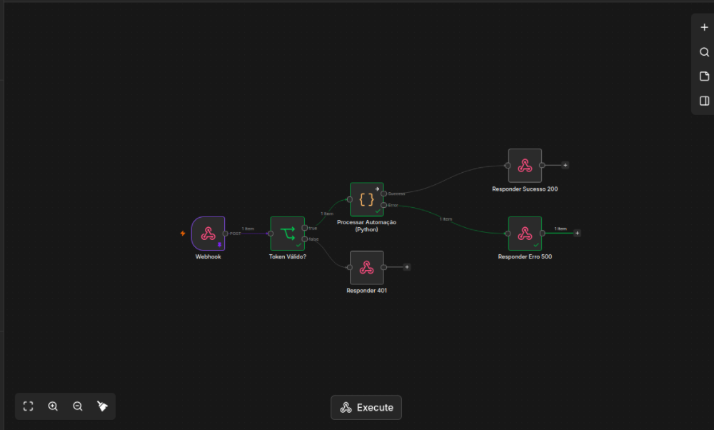

# 🤖 Orquestrador de RPA com n8n e Python (RPA Runner)

[](https://n8n.io)
[](https://python.org)
[](https://github.com)
[](LICENSE)

O **RPA Runner** é um ecossistema de Automação de Processos Robóticos (RPA) orquestrado via **n8n** e alimentado por rotinas de processamento em **Python**. O projeto foi desenhado focando em alta resiliência, arquitetura segura de gatilhos via **Webhook com Autenticação Bearer Token** e tratamento explícito de respostas HTTP (`200 OK`, `401 Unauthorized`, `500 Internal Server Error`).

---

## 📌 Visão Geral do Fluxo de Automação



### 📐 Arquitetura do Workflow

1. **Webhook Inbound (`POST /rpa-runner`):** Ponto de entrada que recebe requisições de clientes ou sistemas externos.
2. **Token Válido? (Validação de Segurança):** Verifica se o cabeçalho `Authorization` contém o valor `Bearer <TOKEN_SECRETO>` esperado.
   * ❌ **Se Inválido:** Direciona para o nó **Responder 401** com erro de autenticação.
   * ✅ **Se Válido:** Direciona o payload para o nó de execução de código.
3. **Processar Automação (Python Code Node):** Processa e valida as regras de negócio enviadas na requisição.
   * 🟢 **Saída de Sucesso:** Direciona para o nó **Responder Sucesso 200** retornando o JSON estruturado.
   * 🔴 **Saída de Exceção (Catch Error):** Captura falhas do script e encaminha para o nó **Responder Erro 500** com o log do erro.

---

## 📂 Estrutura do Repositório

```text
rpa-n8n-python/
│
├── .gitignore               # Arquivos ignorados pelo Git (venv, pycache, .env)
├── .env.example             # Modelo de variáveis de ambiente
├── README.md                # Documentação técnica do projeto
├── requirements.txt         # Dependências do ambiente Python
│
├── docs/
│   └── workflow-preview.png # Imagem do diagrama publicado no n8n
│
├── n8n/
│   └── workflow-rpa.json    # JSON do workflow exportado para importação
│
└── scripts/
    └── rpa_worker.py        # Worker de automação Python
```

---

## 🚀 Como Replicar e Executar o Projeto

Você pode rodar este projeto de duas formas: **Diretamente na Nuvem (n8n Cloud)** ou **Localmente na sua máquina física**.

---

### Opção A: Implantação em Nuvem (n8n Cloud)

1. **Importar o Workflow:**
   * Acesse seu painel no [n8n Cloud](https://n8n.cloud).
   * Clique em **Workflows** ➔ **Import from File**.
   * Selecione o arquivo `n8n/workflow-rpa.json` deste repositório.

2. **Configurar o Token de Segurança:**
   * Abra o nó **Token Válido?**.
   * Edite a expressão de comparação para incluir o seu token definitivo.

3. **Publicar:**
   * Clique no botão **Publish** no canto superior direito para ativar a URL de produção.

---

### Opção B: Implantação Local (Máquina Física / Docker)

#### Pré-requisitos
* **Node.js** (v18+) ou **Docker**
* **Python 3.10+**

#### 1. Configurar o Ambiente Python

```bash
# Clone o repositório
git clone https://github.com/Israzuba0023/rpa-n8n-python.git
cd rpa-n8n-python

# Crie e ative o ambiente virtual
python3 -m venv venv
source venv/bin/activate  # Linux/Mac
# venv\Scripts\activate   # Windows

# Instale as dependências
pip install -r requirements.txt
```

#### 2. Executar o n8n Localmente

```bash
# Instalação global via npm (caso não tenha)
npm install n8n -g

# Inicialização do servidor local
n8n start
```

Acesse a interface no navegador em `http://localhost:5678` e importe o arquivo `n8n/workflow-rpa.json`.

---

## 🧪 Como Testar a API (Validação dos Endpoints)

Você pode utilizar ferramentas como **Postman**, **Insomnia** ou **cURL** no terminal para testar as rotas:

### 1. Teste de Sucesso (HTTP 200 OK)

```bash
curl -X POST https://israzuba0723.app.n8n.cloud/webhook/rpa-runner \
  -H "Content-Type: application/json" \
  -H "Authorization: Bearer MEU_TOKEN_SECRETO" \
  -d '{
    "cliente": "DIO - Desafio RPA",
    "tarefa": "Processamento de Dados",
    "prioridade": "Alta"
  }'
```

**Resposta esperada (200 OK):**
```json
{
  "status": "success",
  "message": "Processo de RPA executado com sucesso.",
  "total_itens": 1,
  "dados": {
    "cliente": "DIO - Desafio RPA",
    "tarefa": "Processamento de Dados",
    "prioridade": "Alta"
  }
}
```

---

### 2. Teste de Acesso Negado (HTTP 401 Unauthorized)

```bash
curl -X POST https://israzuba0723.app.n8n.cloud/webhook/rpa-runner \
  -H "Content-Type: application/json" \
  -H "Authorization: Bearer TOKEN_INVALIDO" \
  -d '{"teste": "dados"}'
```

**Resposta esperada (401 Unauthorized):**
```json
{
  "status": "error",
  "message": "Acesso não autorizado. Token de segurança inválido."
}
```

---

### 3. Teste de Falha de Execução (HTTP 500 Internal Server Error)

Envie um payload malformatado para disparar o tratamento de erro no Python:

```bash
curl -X POST https://israzuba0723.app.n8n.cloud/webhook/rpa-runner \
  -H "Content-Type: application/json" \
  -H "Authorization: Bearer MEU_TOKEN_SECRETO" \
  -d '{"invalid_payload": true}'
```

**Resposta esperada (500 Internal Server Error):**
```json
{
  "status": "error",
  "message": "Erro durante o processamento da automação.",
  "error_details": "KeyError: 'cliente'"
}
```

---

## 🔐 Boas Práticas de Segurança Implementadas

* **Zero Trust Policy:** Nenhuma requisição é processada sem a validação prévia de autorização.
* **Header Authorization:** Evita a passagem de tokens expostos em parâmetros de URL (`Query Params`).
* **Tratamento Resiliente de Exceções:** Falhas no script não derrubam o orquestrador e retornam respostas estruturadas ao cliente.

---

## 👨‍💻 Autor

Desenvolvido por **Israel Cassute (Israzuba0023)** como solução ao Desafio de Projeto da **Digital Innovation One (DIO)**.

* **GitHub:** [@Israzuba0023](https://github.com/Israzuba0023)
